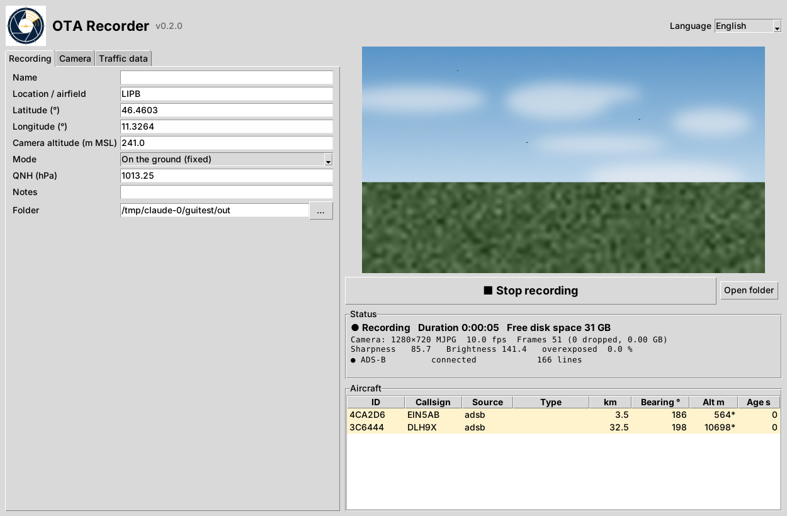

# OTA Recorder – recording guide for club members


The **OTA Recorder** is a small Windows program. It records video from a camera and, at the same
time, the positions of all aircraft around you from ADS-B, FLARM and OGN. From these recordings we
measure how far away the camera can see aircraft. The position data tells us exactly where every
aircraft was, so no manual labelling is needed. That material is what the project needs most.

German quick guide: [recorder.de.md](recorder.de.md).

## What you need

| | Needed? | Notes |
|---|---|---|
| Windows 10/11 laptop | yes | USB 3 port, fast SSD with ≥ 50 GB free |
| USB camera | for video | e.g. the 4K Svpro IMX415 from [hardware.md](hardware.md) |
| RTL-SDR stick + 1090 MHz antenna + dump1090 | recommended | ADS-B, see [setup-windows.md](setup-windows.md#6-ads-b-with-an-rtl-sdr-optional) |
| Internet (phone hotspot is fine) | recommended | FLARM/OGN positions from the Open Glider Network |
| FLARM device with data cable | optional | e.g. the aircraft's PowerFLARM via USB-serial adapter |
| Own OGN receiver (868 MHz) | optional | second RTL-SDR on a Raspberry Pi, see below |

Without a camera the program still records traffic only. That is useful for testing the receivers.

## Install

1. Download `OTA-Recorder-windows.zip` from the
   [releases page](https://github.com/lukepower/optical-traffic-alert/releases).
2. Unzip it anywhere, e.g. to `C:\OTA-Recorder`.
3. Start `OTA-Recorder.exe`. Windows SmartScreen may warn because the program is not signed:
   **More info → Run anyway**.

No Python and no other installation is needed. Settings are stored in
`%APPDATA%\OTA-Recorder\settings.json`. The program's own log is `recorder-app.log` in the same folder.

## The window



Three tabs on the left hold the settings. On the right are the camera preview, the big
start/stop button, the status and the list of received aircraft. Aircraft that should be in the
camera's field of view are highlighted in yellow.

### Tab "Recording"

* **Name** – your name, so we can ask questions later.
* **Location / airfield, latitude, longitude, camera altitude** – where the camera stands. The
  position should be accurate to about 20 m: read it from Google Maps (right-click on the spot)
  and add the airfield elevation plus the camera's height above ground.
* **Mode** – *On the ground (fixed)* for recordings at the airfield. *In the aircraft* is
  experimental: it takes the own position from a connected FLARM.
* **QNH** – today's QNH from the METAR. ADS-B transmits pressure altitude, and QNH converts it to
  real altitude. In the aircraft list such altitudes are marked with `*`.
* **Folder** – where sessions are stored (default `OTA-Sessions` in your user folder).

### Tab "Camera"

* **Device** – `usb:0`, `usb:1`, … (**Search** lists connected cameras).
* **Resolution / frames per second / format** – 3840×2160, 15 fps, YUY2 by default. If the
  status line shows fewer frames than requested, try 10 fps or the MJPG format.
* **Exposure / gain** – leave empty for automatic. If the sky is overexposed (status:
  "overexposed" above 2 %), enter a manual exposure (DirectShow units, e.g. `-8`; smaller = darker).
* **Looking towards** – the true compass direction the camera points at, e.g. 190 for south.
  A phone compass is good enough: it shows magnetic north, so add the local magnetic variation
  (about +3 to +4° in the Alps). The evaluation measures the exact direction from the aircraft it
  finds and corrects it.
* **Tilt up** – how far the camera points above the horizon (0–10°).
* **Horizontal field of view** – depends on lens and zoom. Measure it once
  ([calibration.md](calibration.md)) or estimate it. The evaluation needs it to within about 2°.
* **Preview** – shows the image and a **sharpness** value. Focus on something far away (mountains,
  clouds) and turn the focus ring until the value is at its maximum. Then do not touch the lens again.

### Tab "Traffic data"

* **ADS-B (dump1090)** – address of dump1090's SBS output, normally `127.0.0.1:30003`. If you
  enter the path of `dump1090.exe`, the recorder starts it and stops it at the end.
* **Own OGN receiver** – address of a local OGN receiver (`<IP of the Raspberry Pi>:50001`).
* **FLARM/OGN from the internet** – positions of all FLARM/OGN aircraft within the radius, from
  the OGN servers. Needs internet.
* **FLARM device (NMEA)** – serial port of a FLARM data cable, e.g. `COM4@19200`. Some devices
  also provide the data over Wi-Fi (`192.168.1.1:2000`).

## At the airfield – step by step

1. Ask the airfield operator for permission. Set up somewhere with free view of the approach or
   the circuit, away from people and vehicles. Do not stand in the way of taxiing traffic.
2. Mount the camera firmly on a tripod. Wind shake makes tiny targets jump. Keep the sun out of
   the image.
3. Connect camera and SDR, start dump1090 (or let the recorder start it), and connect internet.
4. Start the program, check the settings, press **Preview**, then focus and set exposure.
5. Press **Start recording**. Within a few seconds the status should show the camera with the
   expected frame rate and the feeds as *connected*. Aircraft appear in the list.
6. Let it run. 30–60 minutes with traffic in the camera's direction is ideal. The recording
   stops by itself when the disk is almost full.
7. Press **Stop recording**. The message box shows where the session folder is.

## What to hand in

Hand in the **whole session folder** (e.g. `20261020-074512Z_LIPB`) on a USB drive or through a
cloud share. It is large: 4K at 15 fps produces about 1–2 GB per minute. Please also tell us
about anything notable (gliders without FLARM, paragliders, drones, birds, weather).

```
20261020-074512Z_LIPB/
  session.json                 all settings, station, camera geometry, statistics
  camera/cam0_000.avi …        video, near-lossless MJPEG, split into ~1.8 GB parts
  camera/cam0.timestamps.csv   exact time of every frame
  traffic.jsonl                every received position, one JSON object per line
  raw/*.txt                    raw ADS-B / OGN / FLARM lines with receive time
  recorder.log
```

## Getting FLARM locally (second SDR stick)

FLARM uses 868 MHz and is decoded by the OGN receiver software (`ogn-rf` + `ogn-decode`). That
software only runs on **Linux**, not on Windows. The practical setup is a Raspberry Pi
(3/4/5) with the second RTL-SDR stick and a ready-made OGN image such as
[ogn-pi34](https://github.com/VirusPilot/ogn-pi34), which can also run ADS-B on a second stick.
Connect the laptop and the Pi to the same network (e.g. the phone hotspot) and enter
`<IP of the Pi>:50001` under *Own OGN receiver*. The recorder reads the same APRS lines as from
the internet, but without delay and without depending on the OGN ground station coverage.

Alternatively, a FLARM device's data port gives the positions of the aircraft *it* receives
(`$PFLAA` sentences). This is the easiest option in an aircraft that already has FLARM.

**ADS-L** (EASA's new 868 MHz standard for light aircraft and drones) is not supported yet. OGN
receivers have started to decode it. If those beacons appear in the OGN APRS feed, the existing
parser should pick them up like any other aircraft. This has to be verified with real data
([roadmap](roadmap.md)).

## Privacy and rules

* Recordings may show people, registrations and private property. Do not publish raw videos.
  The project only publishes selected, checked excerpts.
* OGN data is used under the [OGN data policy](http://wiki.glidernet.org/opt-in-opt-out).
  Aircraft that set the *no-tracking* flag are dropped by the recorder.
* Not for use as a collision-avoidance system. This tool only records.

## Evaluation (for developers)

```powershell
ota evaluate D:\OTA-Sessions\20261020-074512Z_LIPB --overlay
```

For every frame and aircraft, `ota evaluate` computes where the aircraft must appear in the
image, runs the detection pipeline and checks whether something was detected there. It writes
`eval/report.md` with these results:

* **detection range** per aircraft and the probability of detection per range bin
* the **corrected camera heading and pitch**, estimated from the matches
* **confirmed tracks without any cooperative aircraft** (non-cooperative traffic, birds, false
  detections), with crops in `eval/crops/review/`
* auto-labelled **training crops** of real aircraft from our own camera in `eval/crops/aircraft/`
* with `--overlay`, a video showing expected positions (yellow circles) and detections (green boxes
  for cooperative aircraft, magenta boxes for tracks without one)

Try it without a camera on a synthetic session:

```powershell
ota synth-session data\sessions
ota evaluate data\sessions\20261020-080000Z_SYNTH --overlay
```

## Troubleshooting

| Problem | Remedy |
|---|---|
| "camera … delivers no image" | another program is using the camera (close Windows Camera, Teams …); try another `usb:` index |
| far fewer fps than requested | USB 2 port or cable → use a blue USB 3 port; reduce fps; try MJPG |
| many "dropped" frames | disk or CPU too slow → fps 10, close other programs, use an SSD |
| ADS-B "not connected" | dump1090 not running or no `--net`; firewall prompt not confirmed |
| OGN online "not connected" | no internet; corporate networks may block port 14580 |
| FLARM "not connected" | wrong COM port (Device Manager → Ports); baud rate (19200, sometimes 38400/57600) |
| no aircraft in the list although connected | radius too small; position (lat/lon) wrong |
